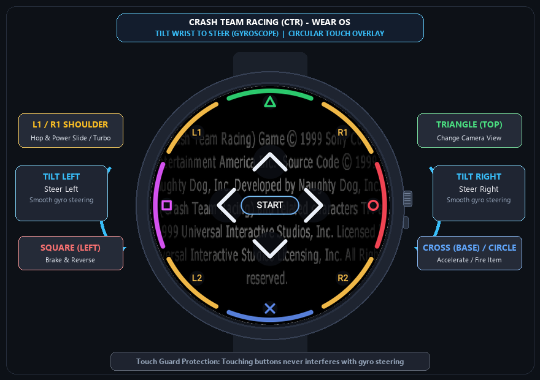

# Crash Team Racing (CTR) - Wear OS & Native Port

A native C/C++ port of **Crash Team Racing** (PS1, 1999) based on the [CTR-ModSDK](https://github.com/CTR-tools/CTR-ModSDK) decompilation, featuring a dedicated native engine and custom touch/gyroscope input stack built specifically for **Wear OS smartwatches** (Samsung Galaxy Watch 4/5/6/7/Ultra, Google Pixel Watch 1/2/3, Xiaomi Watch 2, etc.), plus Android phones and Desktop PCs.

<p align="center">
  
</p>

---

## ⌚ What We Ported & Built for Wear OS

We brought the complete 1999 PS1 classic to modern circular smartwatches running at full **60 FPS** using SDL3, native OpenGL ES 3.0, and 32-bit ARM execution:

- **🏎️ Gyroscope Steering (Tilt to Turn)**: Rotate your wrist naturally like a steering wheel to steer your kart left and right. It delivers ultra-responsive analog steering without blocking the small circular watch screen with on-screen joysticks.
- **🎮 Ergonomic Circular Touch Controls**: All essential PlayStation buttons are mapped directly along the watch's circular bezel with distinct color coding:
  - **`✕` (Bottom)**: Accelerate (Gas)
  - **`□` (Left)**: Brake & Reverse
  - **`○` (Right)**: Fire Weapon / Item
  - **`△` (Top)**: Switch Camera View
  - **`L1` / `R1` (Upper Shoulders)**: Hop & Power Slide (Drift Turbo Boost)
  - **`D-Pad` (`^`, `v`, `<`, `>`)**: Clean chevron arrows for menus and track select
  - **`START` (Center Banner)**: High-contrast center button to Pause / Resume
- **🛡️ Touch Guarding**: Touching buttons on the screen never interferes with or resets the gyroscope steering angle.
- **📳 Haptic Feedback**: Subtle vibration pulses on power slides, item activation, and pause.
- **📸 Built-in Print / Showcase Mode**: A developer toggle (`SHOW_CONTROLS_FOR_PRINT`) applies a high-contrast dark vignette and keeps all controls visible for clean promotional screenshots.

---

## 🚀 How to Build & Install for Wear OS

### 1. Build the Wear OS APK
```bash
cd android
./gradlew :wear:assembleDebug
```
Output APK:
`android/wear/build/outputs/apk/debug/wear-debug.apk`

### 2. Install on your Smartwatch via ADB Wi-Fi
```bash
adb connect <WATCH_IP>:<PORT>
adb install -r android/wear/build/outputs/apk/debug/wear-debug.apk
```

### 3. Game Assets Setup
CTR requires retail NTSC-U game assets to run:
1. On first launch, grant the storage permission and click **"Select File"** in the asset dialog.
2. Select your `ctr-u.bin` or `BIGFILE.BIG`.
3. Or manually copy your game assets to:
   `/storage/emulated/0/Android/data/com.ctrnative/files/assets/`

---

## 💻 Desktop & Android Phone Building

### Prerequisites

#### Windows
The recommended native Windows toolchain is MSVC x86:
1. Install Visual Studio 2022 with **Desktop development with C++** and Windows SDK.
2. Ensure CMake 3.20+ is on `PATH`.
3. Run `build-msvc.bat`, or use CLion CMake presets (`windows-msvc-x86`).

#### Linux (Debian/Ubuntu)
```bash
sudo apt install gcc-multilib libx11-dev libxext-dev libgl1-mesa-dev libasound2-dev libudev-dev libdbus-1-dev
chmod +x build.sh
./build.sh
```

#### Android Phone
```bash
cd android
./gradlew :app:assembleDebug
```
Output: `android/app/build/outputs/apk/debug/app-debug.apk`

---

## 📂 Directory Layout

```
ctr_native/
  main.c              Entrypoint and native platform boundary
  platform/           Native audio, input, memcard, CD, and PSX facade
  build-msvc.bat      Windows build (MSVC x86)
  build.bat           Windows build (MinGW i686)
  build.sh            Linux build
  android/
    wear/             Dedicated Wear OS smartwatch module with Gyro & Touch Overlay
    app/              Standard Android phone/tablet module
  game/               Decompiled CTR game source (CTR-ModSDK)
  include/            Platform facade headers
  externals/
    SDL/              SDL3 source (static build)
```

---

## 📜 Credits & License

- Original game by **Naughty Dog** (1999).
- Reverse engineering and decompilation by the [CTR-ModSDK](https://github.com/CTR-tools/CTR-ModSDK) project.
- Wear OS port, gyroscope steering implementation, and circular touch UI by **Gustavo Lara** ([@gusdslara](https://github.com/gusdslara)).
